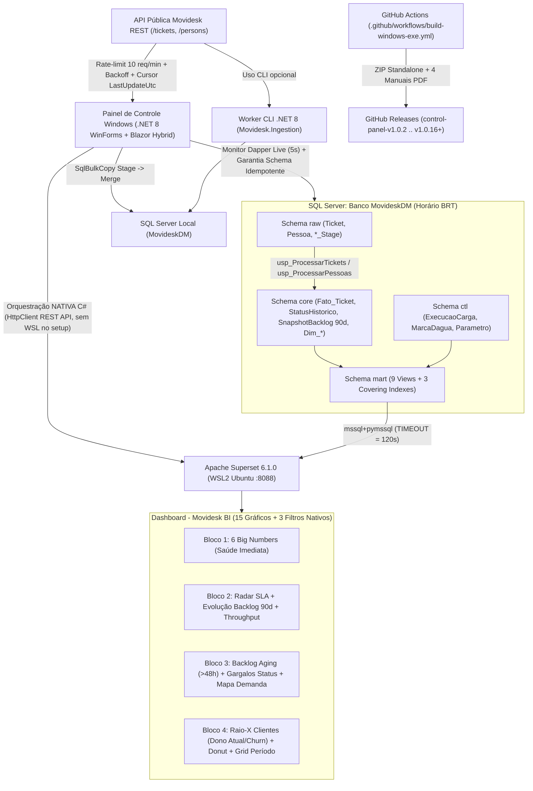

# Histórico Completo & Auditoria Técnica — MovideskDashboard (Advice Compliance Solutions)

> **Escopo:** Registro cronológico completo e auditável de toda a construção, correções de produção, otimizações de performance, automações de BI e entregas documentais do projeto **MovideskDashboard** na branch `main` (do commit inicial [`929e194`](https://github.com/goncajeff-ui/MovideskDashboard/commit/929e194) até [`9c78e47`](https://github.com/goncajeff-ui/MovideskDashboard/commit/9c78e47d7b73e598dc957b198a6fa4e3054613de) e releases `control-panel-v1.0.2` a `v1.0.16`, consolidado com a atualização documental oficial).

---

## 1. Visão Geral da Evolução & Arquitetura Atualizada

O projeto evoluiu de um conjunto inicial de scripts SQL + Worker CLI para um ecossistema corporativo completo composto por: **pipeline SQL Server (`MovideskDM`) versionado em scripts `00` a `08`**, **aplicativo desktop Windows standalone Blazor Hybrid (.NET 8)** com orquestração nativa da REST API do Superset, **9 Views analíticas (`mart.*`) aceleradas por 3 *covering indexes***, **Dashboard Apache Superset 6.1.0 (`Dashboard - Movidesk BI`) com 15 componentes e 3 filtros nativos globais**, **esteira CI/CD no GitHub Actions** e **4 Manuais Corporativos oficiais em PDF/HTML**.

---

## 2. Linha do Tempo Cronológica Passo a Passo (Fases 1 a 8)

### Fase 1 — Fundação do Data Mart, Extrator CLI e Configuração Inicial do Superset (12/11/2026)

| Commit | Data (UTC) | O que foi feito | Arquivos principais |
| :--- | :--- | :--- | :--- |
| `929e194` | 12/11 10:26 | Criação inicial do repositório com `README.md`. | [`README.md`](../../README.md) |
| `c79f242` | 12/11 10:27 | Expansão inicial do `README.md` com visão geral do projeto. | [`README.md`](../../README.md) |
| `0083cf2` | 12/11 16:09 | **Arquitetura Data Mart + Ingestor CLI .NET 8 + Deploy PowerShell + Guia Superset:** criação dos 5 schemas (`raw`, `core`, `mart`, `ctl`, `sec`), tabelas Fato/Dimensão, cargas auxiliares (`Dim_Status`, `Dim_Calendario` 2022–2030, `ctl.Parametro`), procedures RAW→CORE, views analíticas iniciais, Worker CLI (`teste`, `historico`, `incremental`, `pessoas`, `processar`), script [`deploy_local.ps1`](../../deploy_local.ps1), amostrador [`amostra-api-movidesk.ps1`](../../tools/amostra-api-movidesk.ps1) e [`superset_config.py`](../../superset/superset_config.py). | [`00_banco.sql`](../../database/00_banco.sql), [`01_tabelas.sql`](../../database/01_tabelas.sql), [`02_carga_auxiliares.sql`](../../database/02_carga_auxiliares.sql), [`03_views_kpis.sql`](../../database/03_views_kpis.sql), [`04_procedure_processamento.sql`](../../database/04_procedure_processamento.sql), [`Program.cs` (Ingestion)](../../src/Movidesk.Ingestion/Program.cs) |

---

### Fase 2 — Estabilização SQL, Resiliência de API e Nascimento do Executável Desktop (.exe) (13/11/2026)

Esta fase resolveu os primeiros erros reais de deploy local em SQL Server, quebras por *rate-limit* da API Movidesk e substituiu a operação exclusivamente por terminal pela interface gráfica desktop **`MovideskControlPanel.exe`**.

| Commit | Problema / Necessidade | Solução Implementada | Releases / Arquivos |
| :--- | :--- | :--- | :--- |
| `4a7e925` | Erro de driver SqlClient no PowerShell ao rodar o deploy local sem `sqlcmd`. | Fallback automático em [`deploy_local.ps1`](../../deploy_local.ps1) para `System.Data.SqlClient` e `Microsoft.Data.SqlClient`. | [`deploy_local.ps1`](../../deploy_local.ps1) |
| `99af33c` | Erro na procedure `core.usp_ProcessarTickets` ao parsear o array JSON de `tags`. | Alteração da leitura de `tags` para `NVARCHAR(MAX) AS JSON` na extração do JSON RAW. | [`04_procedure_processamento.sql`](../../database/04_procedure_processamento.sql) |
| `5f966e6` & `d999256` | Divergência de colunas de SLA entre tabela fato e procedure (`SlaTempoSolucaoMin` e `SlaTempoRespostaMin`). | Adição idempotente das colunas (`COL_LENGTH`) em [`01_tabelas.sql`](../../database/01_tabelas.sql) e alinhamento dos aliases em `core.usp_ProcessarTickets`. | [`01_tabelas.sql`](../../database/01_tabelas.sql), [`04_procedure_processamento.sql`](../../database/04_procedure_processamento.sql) |
| `6f7d9ff` | Bloqueios HTTP `503`/`504`/`429` em cargas longas e impossibilidade de retomar um `$skip` intermediário. | Retry automático com *exponential backoff* e suporte ao parâmetro de retomada manual via CLI (`skipInicial`). | [`Program.cs` (Ingestion)](../../src/Movidesk.Ingestion/Program.cs) |
| `1ecf50d` | Necessidade de uma ferramenta visual amigável no Windows 10/11 para operar Superset, Banco e Cargas sem linha de comando. | Criação do projeto **`Movidesk.ControlPanel`** (.NET 8 WinForms + BlazorWebView), bat local [`Gerar_Executavel.bat`](../../Gerar_Executavel.bat) e pipeline CI/CD no GitHub Actions. | **`v1.0.2`** · [`Home.razor`](../../src/Movidesk.ControlPanel/Components/Pages/Home.razor), [`build-windows-exe.yml`](../../.github/workflows/build-windows-exe.yml) |
| `c995c93` & `efa75bc` | Erro de build `NU1605` no restore e tela vazia quando o `.exe` rodava em modo *single-file* sem resolver `wwwroot`. | Alinhamento de `Microsoft.Extensions.Configuration.Json` para `8.0.1`, resolução explícita de `wwwroot\index.html` em [`MainForm.cs`](../../src/Movidesk.ControlPanel/MainForm.cs) / [`Program.cs`](../../src/Movidesk.ControlPanel/Program.cs) e validação obrigatória no ZIP de release. | **`v1.0.3`** · [`MainForm.cs`](../../src/Movidesk.ControlPanel/MainForm.cs), [`build-windows-exe.yml`](../../.github/workflows/build-windows-exe.yml) |

---

### Fase 3 — Retomada Inteligente por Cursor, Fuso Horário BRT, Snapshot Histórico 90d & Organizações `/persons` (14/11/2026)

| Commit | O que foi resolvido / entregue | Detalhes técnicos | Releases / Arquivos |
| :--- | :--- | :--- | :--- |
| `32794c2` | Cargas históricas interrompidas precisavam detectar automaticamente onde pararam sem rebaixar tudo do zero. | **Retomada Automática por Cursor (`LastUpdateUtc`):** [`DatabaseMonitorService.cs`](../../src/Movidesk.ControlPanel/Services/DatabaseMonitorService.cs) identifica a fronteira histórica na `raw.Ticket` via função de janela `LEAD()` e a UI passa a exibir *Novos Inseridos (+X)* vs *Atualizados* em tempo real. | **`v1.0.4`** · [`DatabaseMonitorService.cs`](../../src/Movidesk.ControlPanel/Services/DatabaseMonitorService.cs), [`MovideskIngestionService.cs`](../../src/Movidesk.ControlPanel/Services/MovideskIngestionService.cs) |
| `4cfa2ff` | Datas UTC da API causavam contagem errada de *"Hoje"* no Brasil; status novos da Advice não estavam mapeados; não existia série temporal histórica de backlog. | Criação do script **[`05_atualizacao_fuso_status_snapshot.sql`](../../database/05_atualizacao_fuso_status_snapshot.sql)**: (1) conversão UTC → Horário de Brasília (`AT TIME ZONE 'UTC' AT TIME ZONE 'E. South America Standard Time'`), (2) auto-descoberta de status não mapeados (`Mapeado = 0`), (3) cálculo de `DataFim` via `LEAD()`, (4) `core.usp_AtualizarSnapshotBacklog` reconstruindo os últimos 90 dias + foto diária em `core.Fato_SnapshotBacklog`, e (5) criação da 8ª view **`mart.vw_BacklogEvolucao`**. | [`05_atualizacao_fuso_status_snapshot.sql`](../../database/05_atualizacao_fuso_status_snapshot.sql), [`04_procedure_processamento.sql`](../../database/04_procedure_processamento.sql) |
| `71c64e1` | Tickets antigos exibiam o nome da pessoa física solicitante em vez da **Empresa/Organização**; além disso, updates SQL exigiam execução manual via SSMS. | Novo botão **"Sincronizar Empresas (`/persons`)"** + expansão `clients(expand=organization)` vinculando contatos às organizações reais em `core.Dim_Cliente` e `core.Fato_TicketCliente`; criação do dicionário `core.Dim_CampoCustomizado` (ex: `#133948` Versão/Release) e mecanismo de **auto-deploy das procedures/views SQL** dentro do Painel de Controle. | **`v1.0.5`** · [`MovideskIngestionService.cs`](../../src/Movidesk.ControlPanel/Services/MovideskIngestionService.cs), [`Home.razor`](../../src/Movidesk.ControlPanel/Components/Pages/Home.razor) |

---

### Fase 4 — Identidade Visual Corporativa Advice & Manuais 01, 02 e 03 + Dimensão `Serviço` (14/11/2026)

| Commit | Entrega | Detalhes | Releases / Arquivos |
| :--- | :--- | :--- | :--- |
| `087485d` | **Esteira Python de Manuais PDF + Manuais 01 e 02** | Criação de [`gerar_manuais_pdf.py`](gerar_manuais_pdf.py) na paleta corporativa Advice (`#0B3B52` e `#C59217`), gerando [`Manual_01_Operacao_Painel_Controle_Movidesk_BI.pdf`](Manual_01_Operacao_Painel_Controle_Movidesk_BI.pdf) e [`Manual_02_Configuracao_Apache_Superset_Corporativo.pdf`](Manual_02_Configuracao_Apache_Superset_Corporativo.pdf) com capturas recortadas da tela real do Painel. | [`gerar_manuais_pdf.py`](gerar_manuais_pdf.py), `assets/tela_01..04.png` |
| `6dec9c8` & `4cc6fa9` | **Manual 03 — Dicionário de Dados Completo + Releases** | Geração de [`Manual_03_Dicionario_de_Dados_MovideskDM.pdf`](Manual_03_Dicionario_de_Dados_MovideskDM.pdf) e edição completa [`Manual_03_Dicionario_de_Dados_Completo.pdf`](Manual_03_Dicionario_de_Dados_Completo.pdf) (com `INFORMATION_SCHEMA.COLUMNS` e catálogo das Views); empacotamento automático dos PDFs nos anexos das GitHub Releases e na subpasta `manuais/` do ZIP. | **`v1.0.6`** · [`build-windows-exe.yml`](../../.github/workflows/build-windows-exe.yml) |
| `47bd2ac` | **Exposição do campo `Servico` (`ServicoN1`)** | Inclusão da coluna `Servico` nas views `mart.vw_SlaRadar`, `mart.vw_BacklogAging` e `mart.vw_MapaDemanda` + atualização do Manual 03. | **`v1.0.7`** · [`03_views_kpis.sql`](../../database/03_views_kpis.sql) |

---

### Fase 5 — Automação Completa do Superset: De Script Python WSL2 para C# Nativo Sem Dependência Externa (14–15/11/2026)

Esta fase consolidou o provisionamento automático do Apache Superset em cima de lições reais do ambiente Windows + WSL2:

1. **Nascimento do Script Python REST API (`0410477`, 14/11):** Criação de [`setup_superset_auto.py`](../../superset/setup_superset_auto.py) usando apenas `urllib`/stdlib Python para autenticar (`/api/v1/security/login` + CSRF), criar a database `MovideskDM`, registrar os datasets e montar os gráficos e o dashboard no Superset via REST API.
2. **Embarcamento no Painel de Controle (`17aff60`, `v1.0.8`):** Criação do novo card **"Configuração Inicial do Superset"** em [`Home.razor`](../../src/Movidesk.ControlPanel/Components/Pages/Home.razor) com input de senha do `admin`, flag `--password` no Python e execução via `wsl.exe`.
3. **Erro Win32 32KB & Refatoração via `stdin` (`c5af98f`, `v1.0.9`):** Ao enviar o script inline na linha de comando do Windows via `wsl.exe`, o tamanho ultrapassou o limite de ~32KB do `CreateProcess`. O script passou a ser transmitido via `StandardInput` em UTF-8 LF.
4. **Migração Definitiva para C# Nativo via `HttpClient` (`069afdf`, `v1.0.10`):** Mesmo via `stdin`, ocorreram falhas na ponte `wsl.exe` / ambiente Python do host. Toda a orquestração REST API (Login JWT + CSRF, Database `MovideskDM`, Datasets `mart`, Charts, Layout e Filtros Nativos) foi portada para **C# puro dentro de [`SupersetService.cs`](../../src/Movidesk.ControlPanel/Services/SupersetService.cs)** (mantendo [`setup_superset_auto.py`](../../superset/setup_superset_auto.py) sincronizado para execuções manuais em Linux/CLI).

---

### Fase 6 — Correções Superset 6.1.0, Proteção à Carga Incremental e Filtro `Equipe` em Todas as Views (15/11/2026)

| Commit | Bug / Requisito Reportado | Correção Implementada | Releases / Arquivos |
| :--- | :--- | :--- | :--- |
| `7eeecdc` | Erro de tela vermelha no Superset 6.1.0: `echarts_timeseries_area is not registered` + *"Empty query"* por Eixo X ausente no gráfico de Backlog 90d; além de ausência de `Equipe` no `vw_ClienteRaioX`. | Alteração de `viz_type` para `echarts_area` (com `"area": True`), fixação explícita de `"x_axis": "DataSnapshot"` e `"granularity_sqla": "DataSnapshot"`, e adição inicial da coluna `Equipe` ao `vw_ClienteRaioX`. | **`v1.0.11`** · [`setup_superset_auto.py`](../../superset/setup_superset_auto.py), [`SupersetService.cs`](../../src/Movidesk.ControlPanel/Services/SupersetService.cs) |
| `02d36d9` | Clicar em **Disparar Carga Incremental** sobrescrevia alterações manuais das views e resetava dimensões/métricas/`%Total` do gráfico *Raio-X de Clientes*; faltava a coluna `Equipe` nas demais views. | (1) Criação do script exclusivo de `ALTER VIEW`: **[`06_alter_views_filtro_equipe.sql`](../../database/06_alter_views_filtro_equipe.sql)** expondo `Equipe` normalizada em todas as **8 views**; (2) blindagem no [`MovideskIngestionService.cs`](../../src/Movidesk.ControlPanel/Services/MovideskIngestionService.cs) para validar ausência de colunas obrigatórias em vez de sobrescrever views customizadas manualmente no SSMS; (3) reconstrução explícita do modo `aggregate`, métricas, `percent_metrics` (`%Total`) e formatações em `TABELA_CLIENTE_RAIOX`. | **`v1.0.12`** · [`06_alter_views_filtro_equipe.sql`](../../database/06_alter_views_filtro_equipe.sql), [`MovideskIngestionService.cs`](../../src/Movidesk.ControlPanel/Services/MovideskIngestionService.cs), [`SupersetService.cs`](../../src/Movidesk.ControlPanel/Services/SupersetService.cs) |

---

### Fase 7 — Timeout Zero, Novo Nome (`Dashboard - Movidesk BI`), Saneamento Backlog/SLA, Clientes por Período e Regra Final de Raio-X (15/11/2026)

1. **Timeout no Setup, Renomeação Oficial, Discrepância Backlog/SLA e Nova View de Clientes por Período (`faccd60`, `v1.0.13`):**
   - **Timeouts:** Aumento de timeouts HTTP e tratamento gracioso para `PUT /api/v1/database/` e `/refresh` lentos no Superset sem perder o filtro de `Equipe`.
   - **Renomeação:** Substituição de *Sala de Guerra* → **`Dashboard Movidesk`** no Painel de Controle e de *Sala de Guerra - Movidesk BI* → **`Dashboard - Movidesk BI`** (`/superset/dashboard/dashboard-movidesk/`) com migração automática de slug sem duplicar o painel.
   - **Explicação & Correção da Discrepância vs Movidesk Web:** Status encerrados como `Resolvido` ou novos status não mapeados entravam na conta quando `EhFinal` vinha `0`/`NULL`, além de tickets com SLA pausado pelo status (`st.PausaSla = 1`) aparecerem como vencidos. O script **[`07_fix_backlog_sla_e_nova_view_clientes.sql`](../../database/07_fix_backlog_sla_e_nova_view_clientes.sql)** impôs precedência estrita de `t.StatusBase IN ('Resolved', 'Closed', 'Canceled')` em todas as views e na `usp_AtualizarSnapshotBacklog`, considerou `PausaSla = 1` efetivo e atualizou `core.Dim_Status`.
   - **Nova Visualização (#14 e #15):** Criação da 9ª view **`mart.vw_TicketsPorClientePeriodo`** e adição da linha 6 do Dashboard com o gráfico Donut **`Tickets Abertos por Cliente (Organização)`** (`pie`) e o Grid complementar **`Detalhamento de Tickets por Cliente no Período`** (`table` com Qtd e `%Total`).

2. **Nova Regra de Negócio do `vw_ClienteRaioX`: Produto + Dono Atual (`908849e`, `v1.0.14`):**
   - Adoção da regra definida pela gestão em 15/11/2026: como um mesmo cliente é atendido por várias equipes conforme o produto (ex: *e-Guardian*, *Aquila*, *KN1*), a granularidade da `mart.vw_ClienteRaioX` passou a ser **`Cliente + Serviço`**, elegendo como **`Equipe` (Dono Atual)** a equipe do **último ticket** daquele Cliente + Serviço, e ordenando o gráfico no Superset por `Dias Sem Ticket DESC`.

3. **Fim Definitivo do Timeout de 60s no Raio-X, Separação por Serviço no Donut/Grid e Escopo de Filtros Superset 6.1 (`e9bbda2`, `v1.0.15`):**
   - **Causa raiz do timeout de 60s no Superset:** Sob paginação/ordenação `ORDER BY` + `COUNT(*)` gerada pelo Superset (`query_mode: aggregate`), a versão anterior com múltiplos CTEs (`ROW_NUMBER()`, dupla varredura em `core.Fato_Ticket` e `EXISTS` correlacionado) degradava para *nested loops* e excedia os `60s` do servidor web Flask/Superset.
   - **Solução Definitiva ([`08_ajuste_raiox_e_servico_clientes_periodo.sql`](../../database/08_ajuste_raiox_e_servico_clientes_periodo.sql)):**
     - Reescrita de `mart.vw_ClienteRaioX` em **single-pass scan** (`ResumoTickets`), substituindo o `ROW_NUMBER()` pelo empacotamento léxico `MAX(CONVERT(CHAR(19), DataCriacao, 126) + '|' + TicketId_Padded + '|' + Equipe)` + `SUBSTRING(..., 32, 128)`.
     - Criação de **3 Covering Indexes** em [`01_tabelas.sql`](../../database/01_tabelas.sql) e no script `08`: `IX_core_Dim_Cliente_RaioX`, `IX_core_Fato_Ticket_Empresa_RaioX` e `IX_core_Fato_Ticket_DataCriacao_Clientes`.
     - Elevação de `SUPERSET_WEBSERVER_TIMEOUT = 120` em [`superset_config.py`](../../superset/superset_config.py).
   - **Separação por `Serviço` no Donut/Grid:** `PIE_TICKETS_CLIENTE` e `TABELA_TICKETS_CLIENTE_PERIODO` passaram a agrupar por **`Cliente, Servico`**, exibindo apenas os produtos atendidos pela equipe filtrada.
   - **Correção Crítica dos Filtros Nativos no Superset 6.1.0:** População explícita do array `chartsInScope` nos 3 filtros nativos do Dashboard: **`Equipe`** (todos os 15 gráficos), **`Serviço`** (6 gráficos com dimensão `Servico`) e **`Período (Tickets por Cliente)`** (2 gráficos da linha 6).

---

### Fase 8 — Manual Executivo 04 com Prints Reais & Sincronização Documental (15/11/2026)

| Commit | Entrega | Detalhes técnicos | Releases / Arquivos |
| :--- | :--- | :--- | :--- |
| `9c78e47` | **Manual 04 — Leitura Executiva (`Dashboard Movidesk BI`)** | Criação do gerador Python [`gerar_manual_dashboard.py`](gerar_manual_dashboard.py) (motor primário **WeasyPrint** com fallback headless Chrome/Edge), extração automática dos **15 prints reais** (`dash_01` a `dash_15`) para `docs/manuais/assets/` e geração do PDF executivo de **8 páginas** ([`Manual_04_Leitura_Executiva_Dashboard_Movidesk_BI.pdf`](Manual_04_Leitura_Executiva_Dashboard_Movidesk_BI.pdf)) estruturado nos 4 Blocos gerenciais (*O que é*, *Como ler*, *Ação Sugerida*). | **`v1.0.16`** · [`gerar_manual_dashboard.py`](gerar_manual_dashboard.py), [`Manual_04_Leitura_Executiva_Dashboard_Movidesk_BI.pdf`](Manual_04_Leitura_Executiva_Dashboard_Movidesk_BI.pdf) |
| *Atual* | **Sincronização Completa da Documentação Oficial** | Atualização completa de [`README.md`](../../README.md), [`superset/README.md`](../../superset/README.md), dos **Manuais 01, 02 e 03** (passando a cobrir as **9 Views**, **3 Covering Indexes**, **15 Gráficos** e **`Dashboard - Movidesk BI`**) e inclusão deste histórico permanente em `docs/manuais/`. | [`README.md`](../../README.md), [`superset/README.md`](../../superset/README.md), [`gerar_manuais_pdf.py`](gerar_manuais_pdf.py), [`Historico_Passo_a_Passo_Projeto.md`](Historico_Passo_a_Passo_Projeto.md) |

---

## 3. Inventário Técnico Atualizado do Ecossistema

### 3.1. Camada de Banco de Dados (`database/00` a `08` — SQL Server `MovideskDM`)

As alterações das evoluções `05` a `08` já estão **consolidadas** nos scripts base (`01` a `04`) e embarcadas como *EmbeddedResource* no `MovideskControlPanel.exe`, mantendo `05` a `08` como scripts idempotentes para upgrades manuais via SSMS:

| Script SQL | Finalidade e Conteúdo |
| :--- | :--- |
| [`00_banco.sql`](../../database/00_banco.sql) | Cria `[MovideskDM]` em `RECOVERY SIMPLE` com `COMPATIBILITY_LEVEL >= 140` (`OPENJSON`). |
| [`01_tabelas.sql`](../../database/01_tabelas.sql) | Schemas (`raw`, `core`, `mart`, `ctl`, `sec`), tabelas Fato/Dimensão/Controle e **todos os índices (incluindo os 3 Covering Indexes de Raio-X e Clientes por Período)**. |
| [`02_carga_auxiliares.sql`](../../database/02_carga_auxiliares.sql) | Popula `Dim_Status` (`Resolvido`/`Fechado`/`Cancelado` com `EhFinal=1, PausaSla=1`), `Dim_Calendario` (2022–2030), parâmetros (`48h`, `4h`, `60d`) e `Dim_CampoCustomizado` (`#133948` Versão/Release). |
| [`03_views_kpis.sql`](../../database/03_views_kpis.sql) | Definição consolidada das **9 Views `mart.vw_*`** com `Equipe`, `Servico`, precedência `StatusBase`, `PausaSla`, lógica *Dono Atual single-pass* em `vw_ClienteRaioX` e `vw_TicketsPorClientePeriodo`. |
| [`04_procedure_processamento.sql`](../../database/04_procedure_processamento.sql) | `core.usp_AtualizarSnapshotBacklog`, `core.usp_ProcessarPessoas` e `core.usp_ProcessarTickets` (conversão UTC → BRT, auto-mapeamento de status, `LEAD()` para `DataFim`, vínculo organização e campos customizados). |
| [`05_atualizacao_fuso_status_snapshot.sql`](../../database/05_atualizacao_fuso_status_snapshot.sql) | Script cumulativo de upgrade (Organizações, Fuso BRT, Snapshot 90d + reprocessamento RAW sem custo de API). |
| [`06_alter_views_filtro_equipe.sql`](../../database/06_alter_views_filtro_equipe.sql) | Script exclusivo de `ALTER VIEW` para padronização da coluna `Equipe` nas views `mart.*`. |
| [`07_fix_backlog_sla_e_nova_view_clientes.sql`](../../database/07_fix_backlog_sla_e_nova_view_clientes.sql) | Correção de precedência `StatusBase` / `PausaSla`, reconstrução de Snapshot e criação da 9ª view `mart.vw_TicketsPorClientePeriodo`. |
| [`08_ajuste_raiox_e_servico_clientes_periodo.sql`](../../database/08_ajuste_raiox_e_servico_clientes_periodo.sql) | Criação dos 3 Covering Indexes, otimização *single-pass* de `mart.vw_ClienteRaioX` (fim do timeout 60s) e normalização de `Servico` em `mart.vw_TicketsPorClientePeriodo`. |

---

### 3.2. Mapa Completo das 9 Views `mart.*` ↔ 15 Componentes do Dashboard Superset

**Dashboard Oficial:** `Dashboard - Movidesk BI` (`slug: dashboard-movidesk` · auto-refresh `60s` · `cross_filters_enabled: true`)  
**3 Filtros Nativos (Superset 6.1.0 com `chartsInScope` explícito):**
1. **`Equipe`** → atua em **todos os 15 gráficos**.
2. **`Serviço`** → atua nos **6 gráficos** com granularidade de serviço (`#7`, `#10`, `#12`, `#13`, `#14`, `#15`).
3. **`Período (Tickets por Cliente)`** → atua nos **2 gráficos** da Linha 6 (`#14`, `#15`, padrão inicial *"Este mês"*).

| Linha / Bloco | # | Título do Gráfico no Superset | `viz_type` | View `mart.*` Origem | Filtros Ativos |
| :--- | :---: | :--- | :--- | :--- | :--- |
| **Row 1 (Bloco 1)** | 1 | `KPI - Backlog Atual` | `big_number_total` | `mart.vw_VisaoGeralKpis` | Equipe |
| **Row 1 (Bloco 1)** | 2 | `KPI - SLA Vencidos` | `big_number_total` | `mart.vw_VisaoGeralKpis` | Equipe |
| **Row 1 (Bloco 1)** | 3 | `KPI - SLA Iminente (< 4h)` | `big_number_total` | `mart.vw_VisaoGeralKpis` | Equipe |
| **Row 1 (Bloco 1)** | 4 | `KPI - Abertos Hoje` | `big_number_total` | `mart.vw_VisaoGeralKpis` | Equipe |
| **Row 1 (Bloco 1)** | 5 | `KPI - Resolvidos Hoje` | `big_number_total` | `mart.vw_VisaoGeralKpis` | Equipe |
| **Row 1 (Bloco 1)** | 6 | `KPI - FCR 30 Dias (%)` | `big_number_total` | `mart.vw_VisaoGeralKpis` | Equipe |
| **Row 2 (Bloco 2)** | 7 | `Radar Preditivo de SLA (Fila Viva)` | `table` (`raw`) | `mart.vw_SlaRadar` | Equipe, Serviço |
| **Row 3 (Bloco 2)** | 8 | `Evolução Diária do Backlog e SLA Vencido (90 Dias)` | `echarts_area` (`x_axis: DataSnapshot`) | `mart.vw_BacklogEvolucao` | Equipe |
| **Row 3 (Bloco 2)** | 9 | `Throughput Diário: Abertos vs Resolvidos` | `echarts_timeseries_bar` (`x_axis: Data`) | `mart.vw_ThroughputDiario` | Equipe |
| **Row 4 (Bloco 3)** | 10 | `Auditoria de Envelhecimento (Backlog Aging & +48h Sem Ação)` | `table` (`raw`) | `mart.vw_BacklogAging` | Equipe, Serviço |
| **Row 4 (Bloco 3)** | 11 | `Gargalos Operacionais por Status (Horas Úteis e Corridas)` | `table` (`raw`) | `mart.vw_StatusAging` | Equipe |
| **Row 5 (Bloco 3)** | 12 | `Mapa de Demanda por Serviço, Categoria e Versão Release` | `table` (`raw`) | `mart.vw_MapaDemanda` | Equipe, Serviço |
| **Row 5 (Bloco 4)** | 13 | `Raio-X de Empresas Clientes e Radar de Churn (Silenciosos > 60d)` | `table` (`aggregate` + `%Total`) | `mart.vw_ClienteRaioX` | Equipe, Serviço |
| **Row 6 (Bloco 4)** | 14 | `Tickets Abertos por Cliente (Organização)` | `pie` (`donut: true`) | `mart.vw_TicketsPorClientePeriodo` | Equipe, Serviço, Período |
| **Row 6 (Bloco 4)** | 15 | `Detalhamento de Tickets por Cliente no Período` | `table` (`aggregate` + `%Total`) | `mart.vw_TicketsPorClientePeriodo` | Equipe, Serviço, Período |

---

### 3.3. Aplicação .NET 8, Superset, Manuais e CI/CD

- **Painel de Controle Desktop (`src/Movidesk.ControlPanel/`):**
  - [`Program.cs`](../../src/Movidesk.ControlPanel/Program.cs) e [`MainForm.cs`](../../src/Movidesk.ControlPanel/MainForm.cs): Shell WinForms hospedando `BlazorWebView` com confirmação de segurança ao fechar durante carga ativa.
  - [`Home.razor`](../../src/Movidesk.ControlPanel/Components/Pages/Home.razor): Interface única dividida em **Card 1 (Launcher do Apache Superset via WSL2)**, **Card 2 (Monitor de Volumetria Dapper a cada 5s)**, **Card Configuração Inicial do Superset (REST API Nativa C#)** e **Card 3 (Orquestrador de Carga com Retomada por Cursor, Incremental e `/persons`)**.
  - [`MovideskIngestionService.cs`](../../src/Movidesk.ControlPanel/Services/MovideskIngestionService.cs): Orquestra API Movidesk (`Task.Run`, rate-limit por faixa horária comercial/livre, backoff, `SqlBulkCopy`), executa procedures e valida as regras críticas das 9 views sem sobrescrever customizações manuais no SSMS.
  - [`SupersetService.cs`](../../src/Movidesk.ControlPanel/Services/SupersetService.cs): Gerencia o ciclo de vida do contêiner Docker oficial (`apache/superset:6.1.0` via WSL2 / Docker Compose) com probes de `/health` **e executa integralmente em C# nativo (`HttpClient`) o provisionamento de Database + 9 Datasets + 15 Gráficos + Dashboard `Dashboard - Movidesk BI` + 3 Filtros Nativos**, eliminando qualquer dependência de venv Python no host.
- **Ingestor CLI (`src/Movidesk.Ingestion/`):** Worker console .NET 8 (`teste`, `historico [skip]`, `incremental`, `pessoas`, `processar`) mantido para uso headless / tarefas agendadas.
- **Apache Superset (`superset/`):** [`superset_config.py`](../../superset/superset_config.py) (`SUPERSET_WEBSERVER_TIMEOUT = 120`, `pt_BR`, `America/Sao_Paulo`, Feature Flags) e [`setup_superset_auto.py`](../../superset/setup_superset_auto.py) (espelho Python stdlib).
- **Manuais Corporativos (`docs/manuais/`):**
  - [`Manual_01_Operacao_Painel_Controle_Movidesk_BI.pdf`](Manual_01_Operacao_Painel_Controle_Movidesk_BI.pdf) (+ HTML)
  - [`Manual_02_Configuracao_Apache_Superset_Corporativo.pdf`](Manual_02_Configuracao_Apache_Superset_Corporativo.pdf) (+ HTML)
  - [`Manual_03_Dicionario_de_Dados_MovideskDM.pdf`](Manual_03_Dicionario_de_Dados_MovideskDM.pdf) e [`Manual_03_Dicionario_de_Dados_Completo.pdf`](Manual_03_Dicionario_de_Dados_Completo.pdf) (+ HTML)
  - [`Manual_04_Leitura_Executiva_Dashboard_Movidesk_BI.pdf`](Manual_04_Leitura_Executiva_Dashboard_Movidesk_BI.pdf) (+ HTML e 15 prints reais em `assets/`)
- **Instalador Unificado Advice Installer 2.0 (`src/Movidesk.Installer/`):**
  - [`InstaladorManager.cs`](../../src/Movidesk.Installer/Core/InstaladorManager.cs): Orquestrador central simplificado em **4 Etapas Didáticas** (1. Aplicação & Banco de Dados MovideskDM, 2. Infraestrutura Linux & Docker WSL 2, 3. Plataforma Apache Superset & Conectores ODBC 18, 4. Deploy Final do Dashboard Movidesk BI) com descoberta dinâmica do IP do SQL Server (varredura de múltiplos candidatos no WSL2).
  - [`WslEngine.cs`](../../src/Movidesk.Installer/Core/WslEngine.cs): Execução assíncrona com regras de firewall aplicadas com `profile=any` (garantindo liberação da interface Hyper-V / vEthernet WSL) e isolamento do daemon Docker.
  - [`SqlDatabaseDeployer.cs`](../../src/Movidesk.Installer/Core/SqlDatabaseDeployer.cs): Elimina a dependência de ferramentas externas de linha de comando (`sqlcmd.exe` ou SSMS). Executa o provisionamento nativamente em C# via `Microsoft.Data.SqlClient` conectando ao `master`, criando o banco `[MovideskDM]` e aplicando todos os scripts SQL embutidos dividindo em lotes por regex `^\s*GO\s*$`.
  - [`FrmInstalador.cs`](../../src/Movidesk.Installer/UI/FrmInstalador.cs): Interface gráfica moderna em WinForms .NET 8 com layout dinâmico adaptado às 4 etapas, barra de progresso em tempo real, console de log colorido e formulário de inputs com testes de conexão.
- **CI/CD ([`.github/workflows/build-windows-exe.yml`](../../.github/workflows/build-windows-exe.yml) + [`Gerar_Instalador.bat`](../../Gerar_Instalador.bat)):** Publica em cada push na `main` o executável do Instalador Único `MovideskInstaller-Dashboard-Movidesk-BI.exe` (~100 MB com tudo embutido) + `MovideskControlPanel-win-x64.zip` standalone + os 4 Manuais em PDF anexados diretamente na GitHub Release.

---

### Fase 9 — Unificação Arquitetural Docker Host Mode, Teste Real Interno com pymssql e Retry Robusto na Etapa 4 (15/11/2026)

Esta fase eliminou os conflitos de porta 8088 e o isolamento de rede entre contêiner Docker e SQL Server no Windows host que causavam a falha na Etapa 4:

1. **Unificação do Gerenciamento Superset no `SupersetService.cs` (Painel de Controle):**
   - Substituição de chamadas legadas ao virtualenv `~/superset-env` pelo ciclo de vida Docker (`docker start advice_movidesk_superset`).
   - Verificação prévia de `http://localhost:8088/health`: se já estiver respondendo, não sobe novo processo concorrente, evitando o erro `Address already in use / Port 8088 is in use by another program`.
   - Botão "Parar" configurado para parar o contêiner Docker (`docker stop advice_movidesk_superset`) e limpar processos residuais.

2. **Adoção de `network_mode: "host"` no `docker-compose.yml`:**
   - Remoção do mapeamento `ports: - "8088:8088"` e da bridge network isolada. O contêiner agora compartilha diretamente o namespace de rede do WSL2 Ubuntu, eliminando o isolamento de NAT e permitindo acesso direto ao SQL Server no host Windows (`ROUTE_IP` / `172.x.x.1` ou `127.0.0.1`).

3. **Teste Real de Conexão SQL Server de Dentro do Contêiner com `pymssql`:**
   - Tanto no Instalador (`InstaladorManager.cs` / `setup_superset_auto.py`) quanto no Painel de Controle (`SupersetService.cs`, lendo corretamente `ConnectionStrings:MovideskDM`), antes de criar a database `MovideskDM` e os Datasets, executa-se um teste real de conexão (`pymssql.connect()` + `SELECT 1`) **de dentro do contêiner Docker** via script Base64 + JSON e detecção dinâmica do Python (`/app/.venv/bin/python` ou `python3`), testando múltiplos candidatos em ordem: host remoto explícito (quando aplicável), IPs do Windows no WSL (`ROUTE_IP` / `NS_IP`), `host.docker.internal` e `127.0.0.1`.
   - A SQLAlchemy URI (`mssql+pymssql://...`) é montada e atualizada no Superset com o host validado de dentro do contêiner, garantindo que o Superset consiga inspecionar os metadados das 9 views analíticas (`mart.*`) e criar todos os Datasets e Gráficos sem erros HTTP 400/422.

4. **Validação Completa de REST API (90s) na Etapa 4 & Diagnóstico Explícito:**
   - Após o restart do contêiner ao final da Etapa 3 (instalação do driver ODBC 18 e `pymssql`), o método [`AguardarSupersetApiProntaAsync`](../../src/Movidesk.Installer/Core/WslEngine.cs) aguarda até 90 segundos validando `/health`, `POST /api/v1/security/login` e `GET /api/v1/security/csrf_token/` (com JWT + cookies e fallback IPv4 `127.0.0.1`) antes de disparar o provisionamento, além de sincronizar a senha admin via `superset fab reset-password` quando o usuário já existir.
   - Logs detalhados de erros HTTP (`stderr` + resumo de erro do `WslEngine`) foram adicionados à criação de Datasets e Gráficos no `SupersetService.cs` e em `setup_superset_auto.py` para diagnóstico imediato.

---

### Fase 10 — Saneamento Definitivo de Infraestrutura WSL 2 + Apache Superset 6.1.0 (15/11/2026)

Após diagnóstico em ambiente real Windows + WSL 2 onde a Etapa 4 excedia 90 segundos aguardando `/health + login + csrf_token`, foram aplicadas 5 correções estruturais no [`InstaladorManager.cs`](../../src/Movidesk.Installer/Core/InstaladorManager.cs), [`WslEngine.cs`](../../src/Movidesk.Installer/Core/WslEngine.cs), [`SupersetService.cs`](../../src/Movidesk.ControlPanel/Services/SupersetService.cs), [`docker-compose.yml`](../../src/Movidesk.Installer/Resources/docker-compose.yml) e [`superset_config.py`](../../superset/superset_config.py):

1. **Reversão de `network_mode: "host"` para Port Mapping IPv4 Explícito & `127.0.0.1`:**
   - Em WSL 2 com Docker Engine nativo, `network_mode: "host"` impedia o encaminhamento transparente da porta `8088` para o host Windows; o [`docker-compose.yml`](../../src/Movidesk.Installer/Resources/docker-compose.yml) voltou a declarar `ports: - "0.0.0.0:8088:8088"` com `extra_hosts: - "host.docker.internal:host-gateway"`.
   - Adicionada limpeza preventiva de processos nativos órfãos (`pkill -f '[s]uperset' || true`) antes de subir o contêiner e padronização de todas as chamadas `HttpClient` C# em **`http://127.0.0.1:8088`** (evitando timeouts em IPv6 `[::1]:8088` no .NET 8).
2. **`SUPERSET_SECRET_KEY` Fixa & Desativação Segura de CSRF/Talisman:**
   - Eliminada a geração aleatória por instalação em `.env` (que invalidava volumes persistentes `advice_movidesk_superset_home` pré-existentes), gravando sempre `SUPERSET_SECRET_KEY=movidesk_superset_super_secret_key_2026`.
   - Definidos `TALISMAN_ENABLED = False`, `WTF_CSRF_ENABLED = False` e `CONTENT_SECURITY_POLICY_WARNING = False` em [`superset_config.py`](../../superset/superset_config.py); tanto [`AguardarSupersetApiProntaAsync`](../../src/Movidesk.Installer/Core/WslEngine.cs) quanto [`FetchCsrfTokenAsync`](../../src/Movidesk.ControlPanel/Services/SupersetService.cs) consideram a API 100% pronta após `GET /health` HTTP 200 e obtenção de `access_token` em `POST /api/v1/security/login` sem depender de cookie `/csrf_token/`.
3. **Sincronização Forçada de Senha Admin na Etapa 3:**
   - Execução incondicional de `superset fab reset-password` imediatamente após `superset fab create-admin` (com redirecionamento `< /dev/null`), prevenindo `HTTP 401` em volumes reutilizados.
4. **Inversão da Ordem na Etapa 3 (Drivers antes de DB/Init, sem Restart Final):**
   - **Passo A:** `docker compose up -d` | **Passo B:** instalação de `msodbcsql18`, `pyodbc` e `pymssql` | **Passo C:** `docker restart advice_movidesk_superset` para carregar drivers | **Passo D:** `superset db upgrade`, `create-admin`, `reset-password` e `superset init` enquanto o Gunicorn conclui o boot de forma limpa (sem novo restart às vésperas da Etapa 4).
5. **Log Explícito de Cada Tentativa na Etapa 4 & Deploy Direto de Dentro do Contêiner:**
   - [`AguardarSupersetApiProntaAsync`](../../src/Movidesk.Installer/Core/WslEngine.cs) passou a registrar no log o status HTTP ou exceção real de cada tentativa (`Tentativa N: /health=..., /login=...`).
   - O deploy do script [`setup_superset_auto.py`](../../superset/setup_superset_auto.py) na Etapa 4 é executado via `docker exec -i advice_movidesk_superset "$PY_BIN" - --url "http://127.0.0.1:8088" ... < setup_superset_auto.py`, comunicando-se internamente via loopback do contêiner e apontando para o IP Windows validado na porta `1433`.

---

### Fase 11 — Autenticação Mixed Mode Automática, Login `superset_bi` e Parser Nativo `[OK_SQL_HOST]` em C# (15/11/2026)

Após confirmar que a REST API do Superset inicializava na primeira tentativa (`Tentativa 1: /health=200, /login=200`), a Etapa 4 ainda abortava imprimindo `[OK_SQL_HOST]172.18.160.1` seguido de `[AVISO] SQL Server porta 1433 ou banco 'MovideskDM' não acessível` por falha de escape na leitura `awk` em Bash e falta de suporte do `pymssql` à Autenticação Windows pura. Foram aplicadas 3 correções definitivas:

1. **Garantia de Mixed Mode (`LoginMode = 2`) & Login Dedicado `superset_bi` na Etapa 1:**
   - [`SqlDatabaseDeployer.cs`](../../src/Movidesk.Installer/Core/SqlDatabaseDeployer.cs) agora suporta Autenticação Windows direta (campo Usuário SQL vazio em [`FrmInstalador.cs`](../../src/Movidesk.Installer/UI/FrmInstalador.cs)) e *fallback* automático para Autenticação Windows caso o login SQL em host local falhe, atualizando `appsettings.json` em [`ExtratorArquivos.cs`](../../src/Movidesk.Installer/Core/ExtratorArquivos.cs) após o provisionamento SQL.
   - Inspeção automática de `SERVERPROPERTY('IsIntegratedSecurityOnly')`: quando em modo somente Windows, habilita `LoginMode = 2` via `xp_instance_regwrite` + Registro 64 bits do Windows (`HKLM\...\MSSQLServer\LoginMode`) e reinicia o serviço local do SQL Server (`MSSQLSERVER` / `MSSQL$<Instância>`).
   - Criação/atualização idempotente do login SQL dedicado **`superset_bi`** (`CHECK_POLICY = OFF`, `CHECK_EXPIRATION = OFF`, `ENABLE`, permissão `[db_owner]` em `[MovideskDM]` e `[sysadmin]` quando permitido), utilizado automaticamente pelo Instalador ([`ModelosInstalacao.cs`](../../src/Movidesk.Installer/Core/ModelosInstalacao.cs)) e pelo Painel de Controle ([`SupersetService.cs`](../../src/Movidesk.ControlPanel/Services/SupersetService.cs)) quando a conexão local usa Autenticação Integrada.

2. **Diagnóstico Explícito `[ERRO_PYMSSQL]` / `[ERRO_TCP]` & Captura via `Regex` em C#:**
   - Remoção do parser `awk` em Bash que perdia a variável `TARGET_HOST` em [`InstaladorManager.cs`](../../src/Movidesk.Installer/Core/InstaladorManager.cs). Tanto a Etapa 4 quanto `ProbeWorkingSqlHostInsideContainerAsync` em [`SupersetService.cs`](../../src/Movidesk.ControlPanel/Services/SupersetService.cs) extraem `[OK_SQL_HOST]` / `[SQL_HOST_OK]` e `[PY_BIN]` diretamente em C# (`Regex.Match(...).Groups[1].Value.Trim()`).
   - Cada falha de conexão `pymssql.connect()` exibe o erro real em `[ERRO_PYMSSQL] {ip}:{porta}: {exceção}`, com fallback explícito via socket TCP (`[AVISO_TCP]`).

3. **Execução Imediata do Deploy Quando o Host SQL Responde:**
   - Sempre que `[OK_SQL_HOST]` retorna um endereço válido (via `pymssql` ou socket TCP na porta 1433), o Instalador monta a URI escapada com `Uri.EscapeDataString` diretamente no C# e dispara `setup_superset_auto.py` para provisionar `MovideskDM`, os 9 Datasets, os 15 Gráficos e o `Dashboard - Movidesk BI`.
